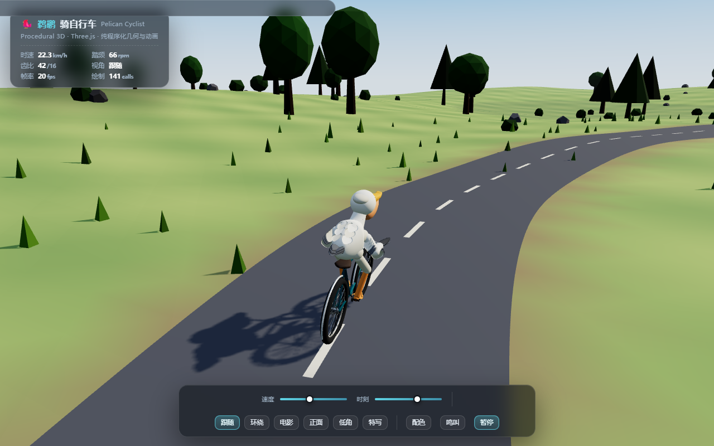
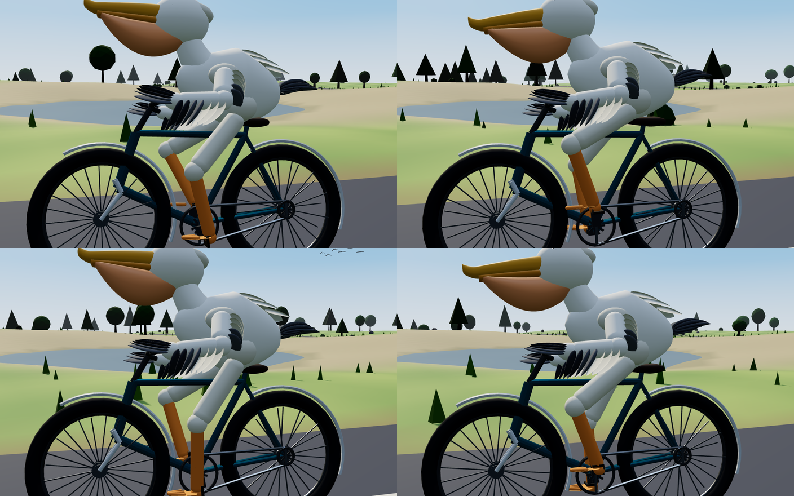
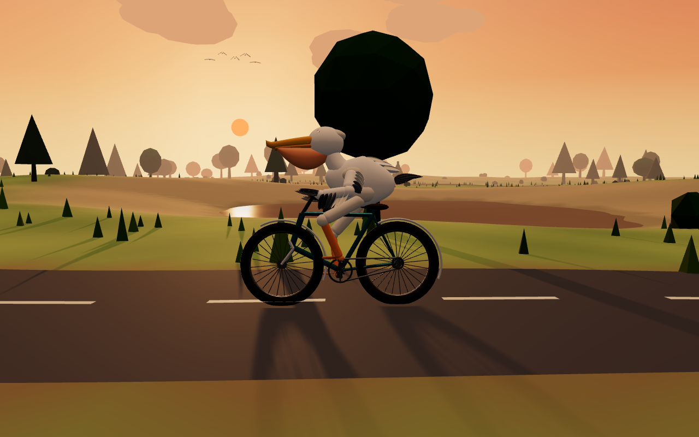
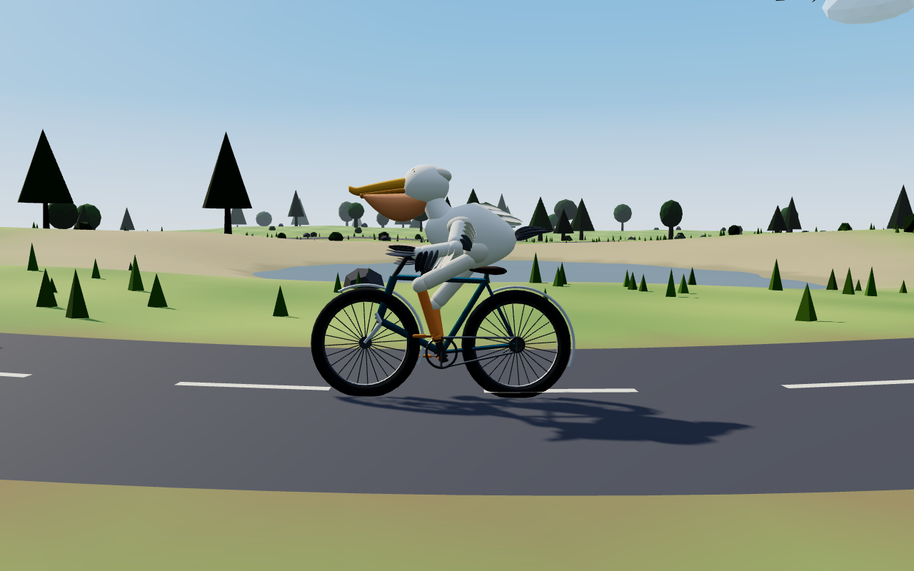
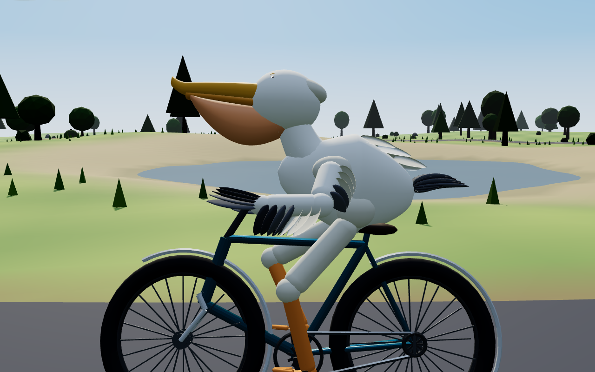
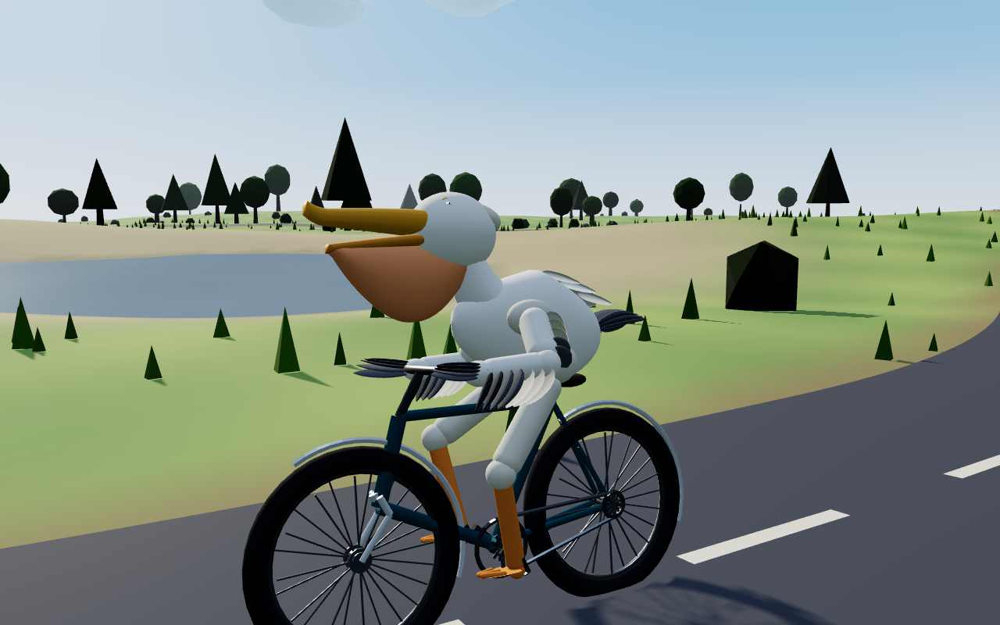
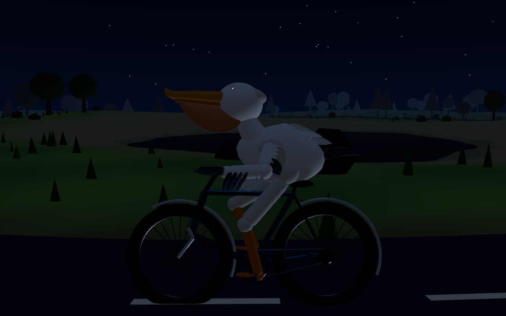

# 🐦 鹈鹕骑自行车 · Pelican Cyclist

**一个完全由代码生成的 Three.js 3D 场景：一只鹈鹕在荒野公路上骑自行车。**

没有任何 3D 模型文件、没有贴图、没有 SVG、没有 2D Canvas、没有预渲染动画——鹈鹕的每一根羽毛、自行车的每一根辐条、地形的每一道起伏，都是运行时用 JavaScript 现算出来的；蹬踏、车轮、身体起伏、脖颈摆动也都是实时解算的。



> 需求原文：*"使用 Three.js 创建一个精致、可交互的 3D 网页场景：一只鹈鹕正在骑自行车。鹈鹕、自行车、环境、动画、灯光、摄像机和交互均通过程序实现。鹈鹕需要真实地骑自行车，并具有协调的腿部、脚踏、车轮和身体运动。不要使用 SVG、2D Canvas、外部 3D 模型或预渲染动画。最终输出一个可以直接在现代浏览器中运行的完整 HTML 文件。"*

---

## 快速开始

**🔗 在线体验：<https://wulusai2333.github.io/pelican-cyclist/>**

```bash
# 直接双击 index.html 也行，但用本地服务器更稳妥
python -m http.server 8000
# 然后打开 http://localhost:8000/
```

唯一的运行要求：**首次加载需要联网**从 CDN 取一次 Three.js r160（页面内置 3 个备用源 + 失败提示）。除此之外零依赖、零构建、零资源文件——就一个 `index.html`。

---

## 操作

| 操作 | 功能 |
| --- | --- |
| 拖拽 | 旋转视角（跟随模式下变成绕车环视） |
| 滚轮 | 推拉镜头 |
| <kbd>←</kbd> <kbd>→</kbd> | 车道内变线（车身会跟着倾斜、车把跟着转） |
| <kbd>↑</kbd> <kbd>↓</kbd> | 提速 / 减速 |
| <kbd>空格</kbd> | 刹车 |
| <kbd>C</kbd> | 切换机位（跟随 / 环绕 / 电影 / 正面 / 低角 / 特写） |
| <kbd>H</kbd> | 鸣叫 |
| <kbd>R</kbd> | 回到起点 |
| 点击鹈鹕 | 鸣叫（喉囊充气、张口，声音为 WebAudio 实时合成） |
| 底部面板 | 速度、时刻（5:00–21:00）、机位、配色、鸣叫、暂停 |

---

## "程序化"到什么程度

| 被禁止的东西 | 实际做法 |
| --- | --- |
| 外部 3D 模型（glTF/OBJ…） | 自写参数曲面 `ParamSurface`：`(u,v) → Vector3` 生成顶点环 + 三角带 + 端盖，法线由绕序保证朝外。身体、喙、喉囊、脖颈、羽片、车座全部由它生成 |
| 骨骼动画 / 预渲染动画 | 双骨 IK（大腿-小腿、上臂-前臂）实时反解，末端锁在脚踏与车把上；躯干起伏、颈部摆动由三角函数与踏频耦合驱动 |
| SVG / 贴图 | 天空是**逐顶点着色**的球体（高度渐变 + 按太阳方向烘焙辉光）；地形、草地颜色写在顶点色里 |
| 2D Canvas | 全部 UI 是普通 HTML/CSS |
| 音频文件 | 鸣叫 = 3 个失谐振荡器 + 噪声 + 低通包络，用 WebAudio 现场合成 |

---

## 骑行是"算"出来的，不是"摆"出来的

| 量 | 关系 | 巡航时的值 |
| --- | --- | --- |
| 车轮角速度 | `ω = v / R`，`R = 0.34 m` | 18.24 rad/s |
| 曲柄角速度 | `ω_曲柄 = ω_车轮 × (16/42)` | 6.95 rad/s → **踏频 66 rpm** |
| 前轮转向角 | `δ = atan(轴距 × κ)`，轴距 1.05 m | 30 m 半径弯道 → 2.0° |
| 车身侧倾 | `φ = atan(v²κ / g)` | 同上 → 7.4° |
| 腿部可达性 | 大腿 0.42 + 小腿 0.38 = 0.80 m；髋到脚踏最远 0.753 m | 膝盖全程不锁死 |

其它联动细节：脚踏板反向自转保持水平；车把与前轮绕**真实头管轴**（后倾 71.6°）偏转；加速时身体前倾、刹车时下沉；过弯时车把、车身、骑手一起倾斜；上下坡时整车俯仰跟随地形；太阳角度变化时阴影方向、天空渐变、雾色、曝光同步改变。


*一个踏频周期的 4 个相位：脚踏到哪，脚就在哪，膝盖随之屈伸。*

---

## 场景里还有什么

**自行车**：正新轮胎（外胎 + 轮圈 + 24 根交叉辐条 + 花鼓合并成单几何体）、菱形车架、后掠车把、握把、车铃、挡泥板、牙盘 / 飞轮 / 链条、曲柄脚踏。

**环境**：解析式起伏地形（保留湖盆与远山包）、随地形起伏的柏油路与中央虚线、带波浪的湖面（湖岸自动生成沙地过渡）、实例化的树 / 灌木 / 石头 / 路边草丛、飘动的低多边形云、天上的雁群、太阳与月亮、夜晚的星空、随时间变化的天空与雾。

**光照**：半球光 + 环境光 + 主平行光（2048² PCFSoft 阴影，阴影视锥跟随骑手）+ 逆光轮廓光，ACES Filmic 色调映射。



---

## 更多截图

| | |
| --- | --- |
|  |  |
|  |  |

> 截图由**无头 Chrome + SwiftShader 软件渲染**自动生成，因此 HUD 上的帧率是软渲染数值，不代表真机（真实 GPU 上场景约 140 个绘制批次）。

---

## 自动化验证

这个仓库里的图不是手点出来的，而是脚本跑出来的——我给自己造了一套"看得见"的闭环：

```bash
# 让仿真以固定步长快进 1.5 秒后冻结，再从正侧方拍一张
tools/shoot.sh screenshots/03-side.png "adv=1.5&freeze=1&nohud=1&cam=1.5708,0.09,2.5,1.05,36"

# 把 4 个踏板相位拼成一张对比图
python tools/contact_sheet.py out.png a.png b.png c.png d.png
```

`index.html` 内置一次性 URL 参数（`adv / freeze / view / cam / tod / speed / honk / nohud`），只影响截图，不干扰正常交互。整个开发过程就是"渲染 → 看图 → 改代码"的循环，逐轮修掉的 11 个问题记录在 **[docs/TEST-REPORT.md](docs/TEST-REPORT.md)**。

---

## 目录结构

```
.
├── index.html                  # 全部内容：几何、动画、光照、交互、UI（~1780 行）
├── README.md
├── LICENSE
├── screenshots/                # 由 tools/shoot.sh 生成
├── docs/
│   └── TEST-REPORT.md          # 能力测试报告：验证方法与逐轮缺陷修复
└── tools/
    ├── shoot.sh                # 无头 Chrome 截图
    └── contact_sheet.py        # 多相位对比拼图
```

`index.html` 内部按 14 个编号小节组织（加载器 / 数学与几何工具 / 渲染器 / 光照 / 天空与时间 / 地形与道路 / 环境散布 / 自行车 / 鹈鹕 / 骑行运动学 / 摄像机 / 交互 / UI / 主循环）。

---

## 已知限制

- 首次加载需联网取 Three.js（无网络时页面会给出明确提示，而不是白屏）。
- 骑手沿固定闭合样条行驶，变线只在路面宽度内左右微调，不是自由驾驶。
- 车轮、脚踏是纯运动学联动，没有物理引擎参与（因此不会打滑、不会摔倒）。

## License

MIT © 2025 wulusai2333
